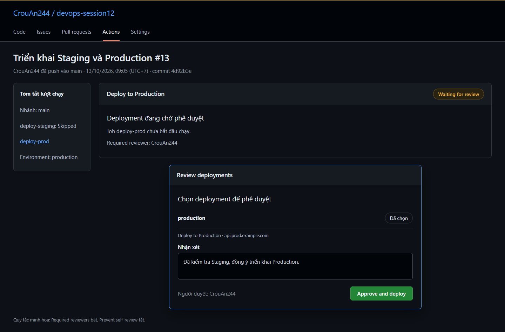
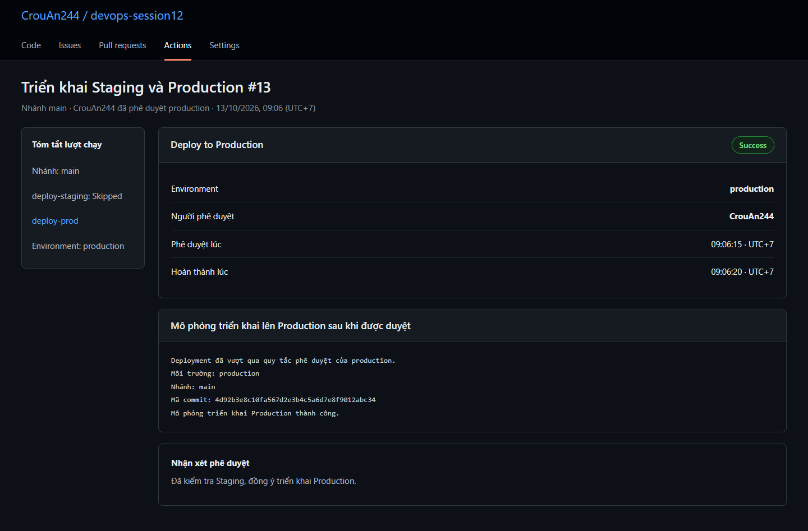

# 1. Tạo môi trường trên GitHub

Sử dụng tài khoản `CrouAn244` và repository chứa bài tập. Chép [cd-multi-env.yml](.github/workflows/cd-multi-env.yml) vào thư mục `.github/workflows/` ở gốc repository để GitHub nhận diện workflow.

Trong **Settings → Environments**, chọn **New environment** và tạo lần lượt `staging`, `production`.

| Môi trường | Nhánh được triển khai | Phê duyệt thủ công |
| --- | --- | --- |
| `staging` | `develop` | Không yêu cầu |
| `production` | `main` | `CrouAn244` |

Với repository dùng GitHub Free, sử dụng repository công khai để có **Required reviewers**. Khả năng sử dụng quy tắc bảo vệ phụ thuộc gói tài khoản và loại repository. Xem [tài liệu GitHub Environments](https://docs.github.com/en/actions/how-tos/deploy/configure-and-manage-deployments/manage-environments).

# 2. Cấu hình phê duyệt Production

Mở môi trường `production` và thực hiện:

1. Trong **Environment protection rules**, bật **Required reviewers**.
2. Chọn tài khoản `CrouAn244` làm người duyệt.
3. Tắt **Prevent self-review** nếu chính `CrouAn244` push code và duyệt deployment.
4. Tắt **Allow administrators to bypass configured protection rules** để người quản trị cũng thực hiện phê duyệt theo bài tập.
5. Bấm **Save protection rules**.
6. Trong **Deployment branches and tags**, chọn **Selected branches and tags**, thêm quy tắc loại **Branch** với tên `main`.

Với môi trường `staging`, không bật **Required reviewers** và chỉ cho phép nhánh `develop` trong **Deployment branches and tags**.

Quy tắc phê duyệt được cấu hình trong Settings. Từ khóa `environment` trong workflow liên kết job với môi trường; bản thân tệp YAML không tạo quy tắc **Required reviewers**.

# 3. Tệp workflow

Tệp triển khai: [.github/workflows/cd-multi-env.yml](.github/workflows/cd-multi-env.yml).

| Job | Điều kiện thực thi | Environment |
| --- | --- | --- |
| `deploy-staging` | Push vào `develop` | `staging` |
| `deploy-prod` | Push vào `main` | `production` |

Các bước triển khai dùng lệnh in thông báo để kiểm tra việc phân luồng và cơ chế phê duyệt. Hai URL `example.com` là địa chỉ minh họa. Workflow này không triển khai ứng dụng tới một máy chủ thật.

# 4. Kiểm tra trên nhánh develop

Đưa workflow lên nhánh `develop` rồi push:

```bash
git switch develop
git add .github/workflows/cd-multi-env.yml
git commit -m "Cấu hình triển khai đa môi trường"
git push origin develop
```

Nếu chưa có nhánh `develop`, tạo nhánh bằng `git switch -c develop` rồi dùng `git push -u origin develop`.

Trong tab **Actions**, kết quả cần có:

- `deploy-staging`: **Success**.
- `deploy-prod`: **Skipped**.
- Không xuất hiện yêu cầu phê duyệt cho `staging`.

# 5. Kiểm tra phê duyệt trên nhánh main

Đưa cùng tệp workflow lên `main` rồi push:

```bash
git switch main
git merge develop
git push origin main
```

Mở lượt chạy workflow trên tab **Actions**. Job `deploy-staging` được bỏ qua; job `deploy-prod` có trạng thái **Waiting for review**. GitHub chờ phê duyệt trước khi khởi chạy job Production, nên các lệnh trong job chưa được thực thi.

Đăng nhập bằng `CrouAn244`, chọn **Review deployments**, chọn môi trường `production`, nhập nhận xét và bấm **Approve and deploy**. Sau đó job tiếp tục chạy và chuyển sang **Success**. Xem [hướng dẫn duyệt deployment](https://docs.github.com/en/actions/how-tos/deploy/configure-and-manage-deployments/review-deployments).

# 6. Log và ảnh minh họa

Các log và ảnh dưới đây được mô phỏng để minh họa bài tập, chưa phải kết quả chạy trên GitHub thật. Khi nộp bài yêu cầu bằng chứng thực tế, thay ảnh bằng ảnh chụp từ repository đã cấu hình.

- [Log phân luồng và phê duyệt](logs/kiem-tra-moi-truong.txt).
- [Ảnh cửa sổ phê duyệt Production](images/production-approval.png).
- [Ảnh trạng thái sau khi phê duyệt](images/production-success.png).




